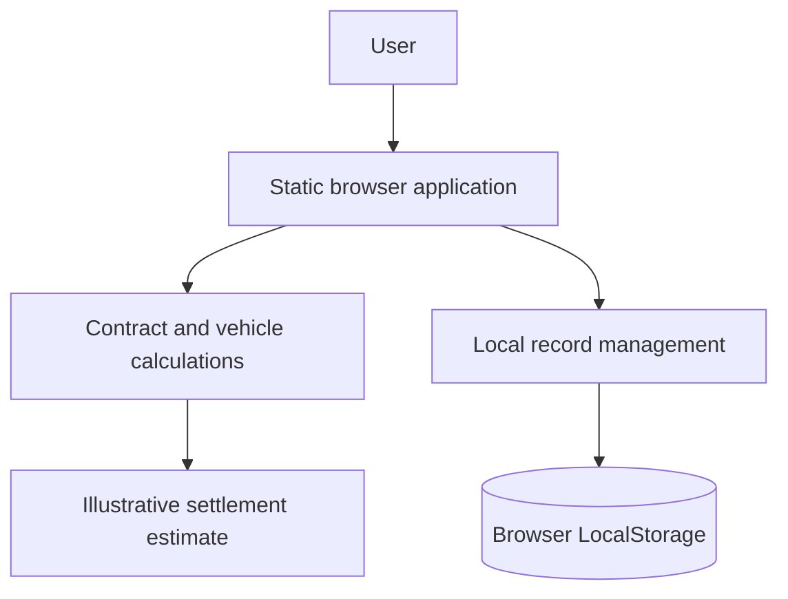

# CarExit Platform

منصة عربية لإدارة تخارج السيارات وعقود التقسيط ومحاكاة التسوية المالية.

## التشغيل
افتح `index.html` محلياً أو انشر المستودع عبر GitHub Pages. التطبيق حالياً واجهة MVP تعمل داخل المتصفح وتحفظ السجلات محلياً باستخدام LocalStorage.

## النطاق الحالي
- تسجيل بيانات السيارة والعقد والأقساط.
- حساب إجمالي المدفوع والمتبقي.
- محاكاة سيناريو التخارج والخصومات والرسوم وصافي التسوية.
- سجل محلي قابل للتعديل والحذف.
- عربي RTL مع تبديل اللغة.

> تنبيه: النتائج تقديرية للمساعدة في اتخاذ القرار وليست تسوية قانونية أو عرضاً ملزماً من ممول. لا ترفع بيانات شخصية أو مستندات حساسة إلى نسخة GitHub Pages العامة. لا يوجد حالياً خادم أو مزامنة بين الأجهزة.

## النشر
من Settings → Pages اختر GitHub Actions. سير العمل الموجود في `.github/workflows/pages.yml` ينشر ملفات الموقع الثابتة تلقائياً عند الدفع إلى main.


## Technical Setup & Verification

CarExit is a static HTML/CSS/JavaScript PWA. It has no backend, package manifest, third-party runtime dependency, or required environment variable.

Run locally:

```bash
git clone https://github.com/zopair/-CarExit-Platform.git
cd -CarExit-Platform
python -m http.server 8000
```

Open `http://localhost:8000/`. The Pages workflow publishes the repository's static files. The latest observed deployment on 12 November 2026 succeeded: [run #43129952698](https://github.com/zopair/-CarExit-Platform/actions/runs/43129952698).

No automated unit/browser test suite was present in the reviewed tree. The Pages run verifies static publication, not the correctness of a financial or legal settlement calculation.

## Proof of Concept & Enterprise Customization Readiness

**Status: Static local calculator and marketplace concept.** The current page includes a contract calculator and local record list. The market section explicitly states that listings are not yet available. All records are stored in the browser's `localStorage`; there is no account system, server, database, synchronization, or live marketplace.

| Area | Current state |
|---|---|
| Vehicle/contract input | Implemented in browser form |
| Paid / remaining installment calculation | Local arithmetic calculation |
| Exit-value, fees, discount, net settlement estimate | Local illustrative calculation |
| Record list / edit-delete lifecycle | Browser localStorage only |
| Contract marketplace listings | Not implemented; page shows an empty state |
| Buyer/seller accounts and messaging | Not implemented |
| Lender approval / contract transfer | Not integrated |
| Legal / accounting settlement | Not certified; estimate only |
| Backend / database | None |
| Offline shell | Service Worker and manifest present |
| Automated tests | None found |
| Deployment | GitHub Pages deployment observed successful 12 November 2026 |
| Project license | No root `LICENSE` file present in the reviewed tree |

### Enterprise readiness gates

1. Validate the calculator formula with a qualified accountant and legal counsel; document lender-specific early-settlement, transfer, and fee rules.
2. Add explicit assumptions, currency handling, rounding, and edge-case tests before using estimates in negotiations.
3. Keep personal contract details local and avoid entering real identifiers into the public GitHub Pages demo.
4. Build secure accounts, backend persistence, authorization, audit history, and document storage only after a privacy/security design.
5. Implement verified listings and lender-approved contract-transfer workflow before presenting the marketplace as live.
6. Add browser tests and a project license before wider distribution.

## Intellectual Property & Authorship

Project authorship and attribution: **Aly Hussein Zopair (علي حسين زبير ALY HUSSEIN ZOPAIR)**.

This attribution does not create a software license or make the financial calculations legal, accounting, lending, or investment advice.

## Architecture



The current architecture is browser-only. It has no server-side account, database, synchronization, lender integration, or legally certified settlement process.

## Change log

- 2026-11-28 — Added architecture documentation and clarified the boundary between browser calculations and verified financial/legal settlement.
